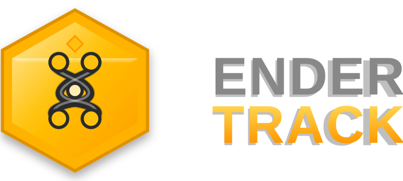

# EnderTrack — imaging v1.3.5

<p align="center">
  
</p>

<p align="center">
  <strong>3D position controller for motorized XYZ stages, with image acquisition.</strong><br>
  Web interface + Python server. Built-in simulator or real control via G-code.
</p>

---

## Getting started

```bash
git clone -b imaging https://github.com/Hugo-LE-GUENNO/EnderTrack.git
cd EnderTrack
sudo python3 endertrack-server.py
```

### Network access

```bash
python3 endertrack-server.py --lan
# → displays the address to open from any device on the same network
```

[Network, hotspot, RPi setup](https://github.com/Hugo-LE-GUENNO/EnderTrack/blob/main/docs/network.md)

[Raspberry Pi optional dependencies](docs/rpi-optional-dependencies.md)

## Extensions

EnderTrack supports two types of plugins. A public community repository is available — browse, install, or contribute your own.

[Community plugins](https://github.com/Hugo-LE-GUENNO/EnderTrack-plugins-community)

### Python plugins

A single `.py` file dropped into `plugins/` — full access to stage, camera, LEDs and waypoint lists through a simple Python API. The easiest way to automate and extend EnderTrack.

[Python plugin tutorial](docs/python-plugins.md)

### Advanced plugins

A JS + optional Python plugin — inject custom UI anywhere in the app, create new tabs, open modals, draw on the canvas, and react to live events. More powerful, more flexible.

[Advanced plugin tutorial](docs/advanced-plugins.md)

## More

[Full documentation, editions](https://github.com/Hugo-LE-GUENNO/EnderTrack)  
[Changelog](docs/changelog.md)

## License

GPLv3 — Hugo Le Guenno, 2025

## Acknowledgements

- [EnderScope](https://github.com/Pickering-Lab/EnderScope) — Pickering Lab (original project)
- Jérôme, Erwan, Brice and Aliénor — EnderTeam
- Wassim Jaziri — logo design
- CNRS / RTmfm ("PPP" Working Group)
